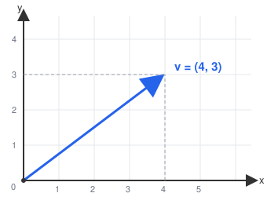
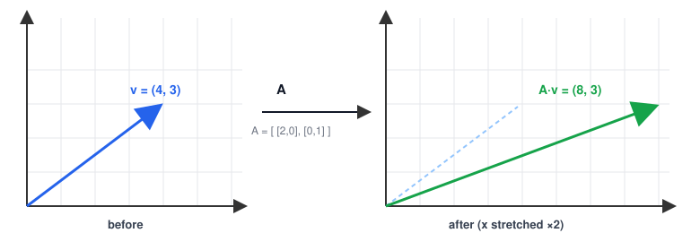
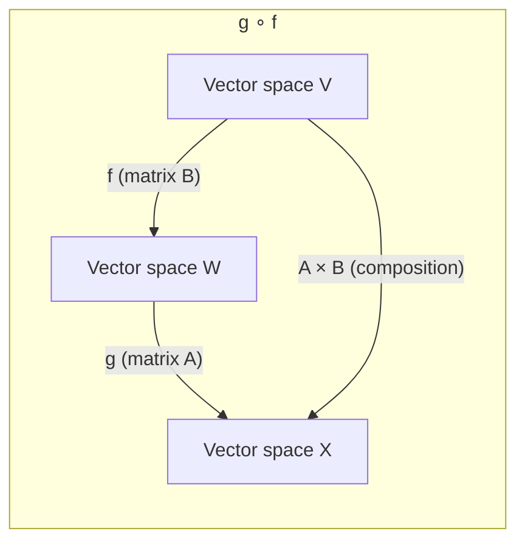
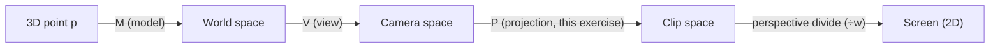
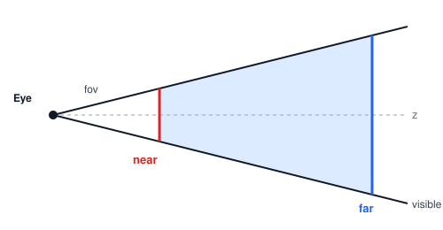

<div align="center">

# 🧮 Matrix — Enter the Matrix

### A from-scratch C++ Linear Algebra library — `Vector<K>` and `Matrix<K>`, generic over any scalar field `K`

*From vectors and dot products to determinants, inverses, and a 3D perspective projection matrix.*

</div>

---

## 📚 Table of Contents

1. [What is a Vector?](#-what-is-a-vector)
2. [What is a Matrix?](#-what-is-a-matrix)
3. [Vector Spaces & Linear Maps](#-vector-spaces--linear-maps)
4. [Why This Matters: GPUs, SIMD & FMA](#-why-this-matters-gpus-simd--fma)
5. [The Exercises](#-the-exercises)
   - [00 · Add, Subtract, Scale](#00--add-subtract-scale)
   - [01 · Linear Combination](#01--linear-combination)
   - [02 · Linear Interpolation (Lerp)](#02--linear-interpolation-lerp)
   - [03 · Dot Product](#03--dot-product)
   - [04 · Norm](#04--norm)
   - [05 · Cosine of the Angle](#05--cosine-of-the-angle)
   - [06 · Cross Product](#06--cross-product)
   - [07 · Linear Map, Matrix Multiplication](#07--linear-map-matrix-multiplication)
   - [08 · Trace](#08--trace)
   - [09 · Transpose](#09--transpose)
   - [10 · Row-Echelon Form](#10--row-echelon-form)
   - [11 · Determinant](#11--determinant)
   - [12 · Inverse](#12--inverse)
   - [13 · Rank](#13--rank)
   - [14 · Bonus — Projection Matrix](#14--bonus--projection-matrix)
   - [15 · Bonus — Complex Vector Spaces](#15--bonus--complex-vector-spaces)
6. [Interludes: Solving Systems & Rank-Nullity](#-interludes-solving-systems--rank-nullity)
7. [Building & Running](#-building--running)
8. [Design Notes](#-design-notes)

---

## 🎯 What is a Vector?

A **vector** is an ordered list of numbers (its *coordinates*), each belonging to a scalar field `K` (here, `float`/`double`, or `Complex` for the bonus). Geometrically, think of it as **an arrow**: it has a *length* (magnitude) and a *direction*.

<p align="center"></p>

In this project, a vector is stored as a simple flat list of `K` values:

```cpp
Vector<double> v({4.0, 3.0});
```

Vectors are used to represent **positions, displacements, velocities, forces**, or — as in the bonus exercise — **points in a 3D scene** about to be rendered on a 2D screen.

---

## 🧊 What is a Matrix?

A **matrix** is a 2D grid of numbers, arranged in **rows** and **columns**. But a matrix is not "just a grid" — it represents a **linear transformation**: a function that takes a vector as input and produces another vector as output, by rotating, scaling, shearing, or projecting it.

```
        ⎡ 2   0 ⎤          Applying A to v = (4, 3):
    A = ⎢       ⎥    →     A·v = (2×4 + 0×3, 0×4 + 1×3) = (8, 3)
        ⎣ 0   1 ⎦
```

<p align="center"></p>

Here, `A` stretches the X-axis by a factor of 2 and leaves Y untouched — a **horizontal scaling**. This is the essence of the whole module: **every matrix is a machine that transforms space**, and the exercises below teach you how to build, combine, and reverse these machines.

In code, a matrix is stored as rows of `K` values:

```cpp
Matrix<double> A({{2.0, 0.0}, {0.0, 1.0}});
```

---

## 🌐 Vector Spaces & Linear Maps

A **vector space** `V` over a field `K` is a set where you can:
- **add** two vectors together (`u + v`)
- **scale** a vector by a scalar (`λ·v`)

...and these operations must respect a handful of intuitive rules (associativity, distributivity, an identity element, etc.) — see [`Chapter II.4`](#) of the subject for the formal axioms.

A function `f : V → W` is a **linear map** if it respects these operations:

```
f(u + v) = f(u) + f(v)        (additivity)
f(λ·u)   = λ·f(u)             (homogeneity)
```

Every linear map between finite-dimensional spaces can be represented **uniquely as a matrix**. Applying the map is just a matrix-vector multiplication (see [exercise 07](#07--linear-map-matrix-multiplication)). Composing two linear maps (apply `f`, then `g`) is just multiplying their matrices together:



---

## ⚡ Why This Matters: GPUs, SIMD & FMA

GPUs excel at **SIMD** (Single Instruction, Multiple Data): running the *same* operation over *many* values in parallel — exactly what vector addition, scalar multiplication, and dot products are. This is why linear algebra sits at the core of computer graphics, physics engines, and machine learning.

**FMA** (Fused Multiply-Add) computes `a×b + c` in a single hardware instruction, with only **one rounding step** instead of two — more accurate and often faster than doing the multiplication and addition separately. Several exercises below (`dot`, `linear_combination`) are required to use it (`std::fma`).

---

## 🔧 The Exercises

> Each section below states **what the function does**, **the formula**, **a worked example**, and **why it's useful**.

### 00 · Add, Subtract, Scale

**What it does**: the three most basic vector-space operations — combine two vectors, or rescale one.

| Operation | Formula | Example |
|---|---|---|
| `add` | `u[i] + v[i]` | `[2,3] + [5,7] = [7,10]` |
| `sub` | `u[i] - v[i]` | `[2,3] - [5,7] = [-3,-4]` |
| `scl` | `u[i] × a`   | `[2,3] × 2 = [4,6]` |

```cpp
Vector<double> u({2.0, 3.0});
u.add(Vector<double>({5.0, 7.0}));   // u == [7, 10]
```

**Used for**: literally everything downstream — every other exercise builds on these.

---

### 01 · Linear Combination

**What it does**: computes a weighted sum of several vectors — `λ₁u₁ + λ₂u₂ + ... + λₖuₖ`.

**Why it matters**: this is *the* foundational operation of linear algebra — a vector space is, by definition, the set of all linear combinations of some starting vectors.

**Example**:
```
u = [1,2,3],  v = [0,10,-100],  coefficients = [10, -2]

linear_combination([u, v], [10, -2])
  = 10×[1,2,3] + (-2)×[0,10,-100]
  = [10,20,30] + [0,-20,200]
  = [10, 0, 230]
```

```cpp
std::vector<Vector<double>> vecs = {u, v};
std::vector<double> coefs = {10.0, -2.0};
Vector<double> result = linear_combination(vecs, coefs);
```

---

### 02 · Linear Interpolation (Lerp)

**What it does**: finds a point on the line between `u` and `v`, parameterized by `t ∈ [0,1]`.

```
lerp(u, v, t) = u + t·(v - u)
```

```
u ─────────────●─────────────────── v
t=0          t=0.3                t=1
```

| `t` | Result |
|---|---|
| `0` | exactly `u` |
| `1` | exactly `v` |
| `0.5` | the midpoint |

**Example**: `lerp([2,1], [4,2], 0.3) = [2,1] + 0.3×[2,1] = [2.6, 1.3]`

**Used for**: animation (moving smoothly between two positions), and — beyond `[0,1]` — defining rays in raytracing.

---

### 03 · Dot Product

**What it does**: multiplies two vectors' matching coordinates and sums the results, producing **a single scalar**.

```
u·v = Σ u[i] × v[i]
```

**Geometric meaning**: measures how much two vectors point in the same direction.

| `u·v` | Meaning |
|---|---|
| `> 0` | vectors point roughly the same way |
| `= 0` | vectors are **orthogonal** (perpendicular) |
| `< 0` | vectors point roughly opposite ways |

**Example**: `[-1,6]·[3,2] = (-1×3) + (6×2) = -3 + 12 = 9`

> 💡 For **complex** vector spaces, the dot product must **conjugate** one of the two vectors (`Σ u[i]×conj(v[i])`) — otherwise `u·u` can become negative, breaking the notion of length. This is the *sesquilinear* inner product (see the [Complex bonus](#15--bonus--complex-vector-spaces)).

---

### 04 · Norm

**What it does**: measures the "size" of a vector, in three different ways.

| Norm | Formula | Nickname |
|---|---|---|
| `norm_1` | `Σ \|v[i]\|` | Manhattan / Taxicab |
| `norm`   | `√(Σ v[i]²)` | Euclidean |
| `norm_inf` | `max(\|v[i]\|)` | Supremum |

**Example** with `v = [1, 2, 3]`:
```
norm_1   = |1| + |2| + |3| = 6
norm     = √(1 + 4 + 9) = √14 ≈ 3.7417
norm_inf = max(1, 2, 3) = 3
```

**Key identity**: `norm() = √(dot(v, v))` — the Euclidean norm is literally the square root of the dot product of a vector with itself.

> 📐 **Triangle inequality**: `‖u + v‖ ≤ ‖u‖ + ‖v‖` — going directly from A to C is never longer than going A→B→C. This is what lets a norm define a valid *distance*. The three norms above are special cases (`p=1`, `p=2`, `p=∞`) of the general **Hölder p-norm** `‖v‖ₚ = (Σ|v[i]|^p)^(1/p)`, and the Minkowski inequality generalizes the triangle inequality to any `p`. A matrix has its own analogous norm, the **Frobenius norm** (treat the matrix as a flattened vector and take its Euclidean norm).

---

### 05 · Cosine of the Angle

**What it does**: computes `cos(θ)`, the cosine of the angle between two vectors, by isolating it from the geometric dot-product formula `u·v = ‖u‖‖v‖cos(θ)`.

```
cos(u, v) = (u·v) / (‖u‖ × ‖v‖)
```

**Example**: `u=[1,2,3]`, `v=[4,5,6]` → `cos = 32 / (3.7417 × 8.7750) ≈ 0.9746` (a small angle — the vectors nearly point the same way).

**Used for**: this is exactly **cosine similarity**, ubiquitous in data science / NLP (comparing document or embedding vectors). Its statistical twin is the **Pearson correlation coefficient**: replace `dot` with *covariance* and `norm` with *standard deviation*, and you get the same formula measuring how correlated two random variables are.

---

### 06 · Cross Product

**What it does**: for two 3D vectors, produces a **new vector**, perpendicular to both, whose length equals the area of the parallelogram they form.

```
u × v = ( u₂v₃ - u₃v₂,  u₃v₁ - u₁v₃,  u₁v₂ - u₂v₁ )
```

**Example**: `[4,2,-3] × [-2,-5,16] = [17, -58, -16]`

> 🌀 The cross product is actually a *shortcut* specific to 3D — the more general and "well-behaved" tool is the **wedge product** `u∧v`, which produces a **bivector** (an oriented plane element, not a vector). The cross product is the *dual* of the wedge product, and this duality only reduces to "a vector" in exactly 3 dimensions — which is why cross products don't generalize to other dimensions the way wedge products do.

---

### 07 · Linear Map, Matrix Multiplication

**What it does**: applies a linear transformation. Matrix × vector transforms a point; matrix × matrix **composes** two transformations.

```
(A·u)[i]   = Σⱼ A[i][j] × u[j]
(A·B)[i][j] = Σₖ A[i][k] × B[k][j]
```

**Example** — matrix-vector:
```
A = [[2,-2],[-2,2]],  u = [4,2]
A·u = [2×4 + -2×2, -2×4 + 2×2] = [4, -4]
```

**Example** — matrix-matrix:
```
A = [[3,-5],[6,8]],  B = [[2,1],[4,2]]
A·B = [[3×2-5×4, 3×1-5×2], [6×2+8×4, 6×1+8×2]] = [[-14,-7],[44,22]]
```

**Used for**: this is the entire engine behind [Interlude 00](#-interludes-solving-systems--rank-nullity) (solving equations) and the [projection matrix bonus](#14--bonus--projection-matrix).

---

### 08 · Trace

**What it does**: sums the elements on the main diagonal.

```
Tr(A) = Σ A[i][i]
```

**Example**: `Tr([[2,-5,0],[4,3,7],[-2,3,4]]) = 2 + 3 + 4 = 9`

---

### 09 · Transpose

**What it does**: flips a matrix over its diagonal — row `i` becomes column `i`. An `m×n` matrix becomes `n×m`.

```
        ⎡ 1 2 3 ⎤            ⎡ 1 4 ⎤
    A = ⎢       ⎥   Aᵀ =     ⎢ 2 5 ⎥
        ⎣ 4 5 6 ⎦            ⎣ 3 6 ⎦
```

> 🔀 For **complex** matrices, the "real" transpose used in physics/electronics is the **conjugate transpose** (`transpose` + `conj` on every element) — because a complex number `a+bi` can be represented as a 2×2 rotation-scaling matrix `[[a,-b],[b,a]]`, whose transpose corresponds exactly to the conjugate `a-bi`.

---

### 10 · Row-Echelon Form

**What it does**: reduces a matrix, via **Gauss-Jordan elimination**, until every row has a leading `1` (a *pivot*), with `0`s everywhere else in that pivot's column.

**The algorithm** (column by column):
1. Find a non-zero entry at or below the current pivot row, in the current column.
2. **Swap** it into the pivot row.
3. **Normalize**: divide the whole pivot row by the pivot value.
4. **Eliminate**: subtract a multiple of the pivot row from every other row, to zero out that column everywhere else.
5. Move to the next column.

**Example**:
```
[1 2]        [1 0]
[3 4]   →    [0 1]     (a non-singular matrix reduces to the identity)

[1 2]        [1 2]
[2 4]   →    [0 0]     (row 2 was just 2×row 1 — redundant, collapses to zero)
```

---

### 11 · Determinant

**What it does**: computes a single scalar `det(A)`, defined recursively via **Laplace / cofactor expansion**:

```
n = 1:  det([a]) = a
n > 1:  det(A) = Σⱼ (-1)^j × A[0][j] × det(minor(0, j))
```

where `minor(i,j)` is `A` with row `i` and column `j` removed. Each smaller determinant "recycles" the technique of the dimension below it, down to the trivial `1×1` case.

**Example**:
```
det([[8,5,-2],[4,7,20],[7,6,1]])
 = 8×(7×1-20×6) - 5×(4×1-20×7) + (-2)×(4×6-7×7)
 = 8×(-113) - 5×(-136) - 2×(-25)
 = -904 + 680 + 50 = -174
```

> ❓ **What does `det(A) = 0` mean?**
> The transformation **collapses** space into a lower dimension — for example, flattening a 2D plane onto a single line (zero area). This happens exactly when the matrix's rows/columns are **linearly dependent**. A matrix with `det(A)=0` is called **singular**, and has **no inverse** (see [Interlude 00](#-interludes-solving-systems--rank-nullity)).
>
> ❓ **What does the determinant represent geometrically?**
> `|det(A)|` is the **scaling factor of area/volume** that the transformation applies: take the unit square (or cube) formed by the basis vectors, apply `A`, and `|det(A)|` is the area/volume of the resulting parallelogram/parallelepiped. The **sign** tells you whether orientation is preserved (`+`) or flipped like a mirror (`-`).
>
> 🌀 In the language of exterior algebra: the determinant is the magnitude of the **pseudoscalar** formed by wedging together all of `A`'s column vectors (an n-dimensional oriented "volume element").

---

### 12 · Inverse

**What it does**: finds `A⁻¹` such that `A⁻¹A = AA⁻¹ = I`.

**The trick**: augment `A` with the identity, `[A | I]`, and run the *exact same* Gauss-Jordan elimination from exercise 10 on this wider matrix. Once the left half becomes `I`, the right half **is** `A⁻¹`:
```
[A | I]  --(Gauss-Jordan)-->  [I | A⁻¹]
```

**Example** (from [Interlude 00](#-interludes-solving-systems--rank-nullity)):
```
A = [[2,3],[-7,4]]   →   A⁻¹ = [[4/29, -3/29], [7/29, 2/29]]
```

If `det(A) = 0`, the matrix is singular and **cannot** be inverted — this implementation throws a `std::domain_error` in that case.

---

### 13 · Rank

**What it does**: counts the number of **linearly independent** rows/columns — i.e., the number of non-zero rows left after `row_echelon()`.

**Intuition**: two vectors like `[1,0]` and `[2,0]` point in the *same* direction — together they still only span a line (rank 1), not the whole plane (which would be rank 2). The rank tells you the **dimension of the image** — how much of the output space is actually reached by the transformation.

**Example**: `[[1,2],[2,4]]` reduces to `[[1,2],[0,0]]` → only 1 non-zero row → **rank = 1** (row 2 carried no new information).

---

### 14 · Bonus — Projection Matrix

**What it does**: builds the perspective projection matrix `P` used in every 3D rendering pipeline, converting a 3D point into 2D screen coordinates via `s = P·V·M·p` (Model → View → Projection).



**The formula** (with `scale = 1/tan(fov/2)`):
```
     ⎡scale/ratio         0         0           0                     ⎤
 P = ⎢0                   scale     0           0                     ⎥
     ⎢0            0        far/(far-near)      -(far×near)/(far-near)⎥
     ⎣0                   0         1           0                     ⎦
```

This maps the **frustum** (the truncated pyramid of everything visible between the `near` and `far` planes) into Normalized Device Coordinates: `[-1,1]` for X/Y, `[0,1]` for Z.

<p align="center"></p>

> ⚠️ **Column-major output**: the display tool expects each **line** of the exported file to be a **column** of `P`, not a row. Since `transpose()` swaps rows and columns, printing the *rows* of `P.transpose()` is exactly equivalent to printing the *columns* of `P`.
>
> ⚠️ **Near/far and depth precision**: pushing `near` very small and `far` very large exaggerates a real problem — the Z mapping is **non-linear**, so precision is concentrated near the `near` plane and becomes very coarse near `far`. Extreme ratios cause visible artifacts ("z-fighting": flickering between two surfaces the depth buffer can no longer tell apart).

---

### 15 · Bonus — Complex Vector Spaces

**What it does**: redoes *every* exercise above with `K = Complex` instead of `K = f32` — proving the whole library was written generically, not hard-coded to real numbers.

A complex number `a + bi` is stored as two `double`s, with its own `+`, `-`, `*`, `/`:
```
(a+bi) + (c+di) = (a+c) + (b+d)i
(a+bi) × (c+di) = (ac-bd) + (ad+bc)i
(a+bi) ÷ (c+di) = [(ac+bd) + (bc-ad)i] / (c²+d²)
```

**The subtle part — three standard-library functions don't support custom types**:

| Function | Problem | Fix |
|---|---|---|
| `std::fma` | undefined for a custom `Complex` | write `Complex fma(a,b,c)` as a free function; call it unqualified after `using std::fma;` so [ADL](https://en.cppreference.com/w/cpp/language/adl) picks the right one for each type |
| `std::conj` | for a `double`, surprisingly returns `std::complex<double>`, not `double`! | write our **own** `conj_helper` (identity for real types, `.conj()` for `Complex`) — can't reuse `std::conj` at all here |
| `std::pow` | undefined for `Complex` | write `pow_helper` (delegates to `std::pow` for reals; extracts the real part for `Complex`, since a properly-conjugated dot product with itself is always real) |

```cpp
Vector<Complex> u({Complex(2,3), Complex(4,8)});
Vector<Complex> v({Complex(1,1), Complex(2,-1)});

u.dot(v);      // = 5 + 21i   (conjugates v first: Σ u[i]×conj(v[i]))
u.norm();      // = 9.64365   (always a real double, even for complex vectors)
u.add(v);      // = [3+4i, 6+7i]
```

> 🔬 **Why physics cares**: quantum mechanics represents states as complex vectors, and the inner product `⟨ψ|φ⟩` (*bra-ket notation*) is literally this conjugated dot product. Electronics and control systems use complex numbers (*phasors*) to encode a signal's amplitude and phase simultaneously.

---

## 🔗 Interludes: Solving Systems & Rank-Nullity

**Solving `Ax = b`**: a linear system
```
2x + 3y = 8
-7x + 4y = 2
```
is just `A·x = c` in disguise. Since matrix "division" doesn't exist, you multiply both sides by `A⁻¹` on the **left**:
```
Ax = c  ⇒  A⁻¹Ax = A⁻¹c  ⇒  x = A⁻¹c
```
For `A = [[2,3],[-7,4]]`, `A⁻¹ = [[4/29,-3/29],[7/29,2/29]]`, giving `x = [26/29, 60/29]`.

**The Rank-Nullity Theorem**: `rank(f) + null(f) = dim(E)`
- **Image** `im(f)`: the set of outputs actually reached (= the column space of the matrix).
- **Kernel** `ker(f)`: the set of inputs squished to zero (= the null space).
- **Rank**: `dim(im(f))` — the number of pivots in row-echelon form.
- **Nullity**: `dim(ker(f))` — the leftover, "collapsed" dimensions (`n - rank`).

Example: `A=[[1,2],[2,4]]` sends `(x,y) → (x+2y)·(1,2)` — the image is a line (rank 1), the kernel is the line `x=-2y` (nullity 1), and `1+1 = 2 = dim(R²)`. ✅

---

## 🏗️ Building & Running

```bash
make            # builds the ./matrix executable
./matrix        # runs every exercise's tests, colour-coded by section
```

The `Makefile` compiles with `-Wall -Wextra -Werror`. Headers follow a `.hpp` (declarations) / `.tpp` (template definitions, included at the bottom of the `.hpp`) split, since template code must be visible at every point of instantiation.

---

## 🧩 Design Notes

- **Generic by design**: every function is templated on `K` — the same source code works for `float`, `double`, and the bonus `Complex` type, without duplication.
- **Pure vs. mutating style**: exercise 00's `add`/`sub`/`scl` mutate `*this` in place (matching the subject's Rust `&mut self` prototypes); everything from `operator+`/`operator-`/`operator*` onward returns a **new** object, leaving inputs untouched — needed so a single `lerp<V>` can work uniformly across scalars, vectors, and matrices.
- **Encapsulation, carefully**: `_vector`/`_matrix` are `private`, but since C++ visibility is *per class* (not per object), any method of `Vector<K>`/`Matrix<K>` can freely read another instance's internals — used throughout instead of going through the public (often `const`) getters.
- **Customization points via ADL**: rather than special-casing `Complex` everywhere, the library defines small generic "hook" functions (`fma`, `conj_helper`, `pow_helper`, `abs_helper`, `to_real_helper`) that Argument-Dependent Lookup resolves to the right overload — the exact same technique the standard library uses for `std::swap`.
